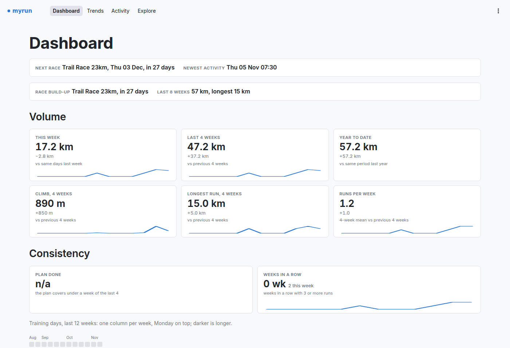

# myrun

A self-hosted training dashboard for runners who already keep their data in
[statistics-for-strava](https://github.com/robiningelbrecht/statistics-for-strava). It reads
that tool's SQLite database (read-only), adds optional wellness, plan, race and Garmin files,
and answers four questions in a [Streamlit](https://streamlit.io) app. It never contacts
Strava or Garmin, so it needs no API keys and runs entirely on your own machine.



- **Dashboard**: cards for volume (with the share of the plan done), load and fitness
  (with VO2max and the easy share of running time, from the Garmin input), and recovery,
  each against the period before; a consistency row with the run streak and a 12-week
  calendar of training days; the build-up to the next race against the same point
  before the last similar one; weekly load and weekly kilometres against the plan; this week's
  sessions; recent runs.
- **Trends**: aerobic efficiency, volume, best efforts, shoe mileage, races, and running dynamics
  over time when the Garmin input is set.
- **Activity**: heart rate, pace, elevation and cadence over one run, time in zones,
  heart-rate drift, laps, an overlay with another run, and the run's running dynamics
  against your recent runs on the same surface.
- **Explore**: any metric against any other, per run or per kilometre, grouped by
  hour of day, temperature, surface, climb or descent, and more.

Every number comes from a function in the `myrun` Python package, so the same data
is one import away in a notebook.

## What it needs

**Required:** the statistics-for-strava SQLite file (`storage/database/strava.db`). myrun opens
it read-only and checks at start-up that these tables and the columns it reads exist:
`Activity`, `ActivityStream`, `ActivitySplit`, `ActivityLap`, `ActivityBestEffort`. A missing
one stops the app with a message naming it. Shoe mileage also uses the `Gear` table; without
it that panel is just empty. Per-km heart rate and the Activity page need the activity streams
to be imported in statistics-for-strava.

**Optional:** four more inputs. Leave one out and its panels disappear; a broken one shows
an error notice on the pages that use it, and `python -m myrun.report status` lists them all.

| Input | File | Config key |
|---|---|---|
| Wellness | Parquet, one row per day | `inputs.wellness_parquet` |
| Plan | CSV | `inputs.plan_csv` |
| Race log | CSV with your own headers | `inputs.race_log_csv` + `race_log_columns` |
| Garmin activities | CSV or Parquet, one row per activity | `inputs.garmin_activities` |

The database, the wellness file and the Garmin file are marked stale when older than
`thresholds.stale_hours` (36 by default). myrun never
writes these files; you produce them however you like (an export script, a spreadsheet).

### Wellness (Parquet)

One row per day. `date` is required, plus at least one metric column.

| Column | Meaning |
|---|---|
| `date` | day (date or timestamp; a timezone is dropped) |
| `readiness`, `body_battery`, `stress` | scores |
| `sleep_hours` | hours slept (or give `sleep_seconds` and map it, see below) |
| `hrv_ms` | overnight HRV in ms |
| `resting_hr` | bpm |
| `sleep_score`, `deep_sleep_seconds`, `rem_sleep_seconds` | optional, shown as detail on the Sleep card |
| `hrv_status` | optional text, shown as detail on the HRV card |

If your file uses other names, map them under `wellness_columns` in the config
(`field: your column`; see `config.example.yaml`). A mapped column that is absent from the
file is an error.

### Plan (CSV)

```csv
date,session,type,distance_km
2026-01-05,Easy run,easy,8
2026-01-06,Rest,rest,
2026-01-10,Long run,long,18
2026-02-01,City 10K,race,10
```

- `date` ISO (`YYYY-MM-DD`), `session` a free-text name, `type` a free-text kind, lower-cased
  on reading. Use `race` for races: the Dashboard's race build-up looks for the next row of
  that type. `rest` and `strength` rows are ignored when matching plan to runs.
- `distance_km` is optional and may be empty.
- Optional extra columns: `surface` (`road`, `mixed` or `trail`) and `elevation_m` (planned
  climb). They only help the race build-up pick a comparable earlier race.
- If no row falls in the current Monday to Sunday week, the plan is shown as "empty"
  (out of date) rather than as current.

### Race log (CSV)

Your headers can be anything; the config maps them to myrun's field names. Only `name` and
`date` are required. The left side is the field, the right side the header in your file:

```yaml
race_log_columns:
  name: Race
  date: Date
  type: Surface            # road, trail or mixed
  distance_km: Distance
  official_time: Time      # H:MM:SS
  rank_pct: Rank %         # a trailing % sign is fine
  garmin_url: Garmin
race_log_date_format: "%d/%m/%Y"   # strftime format of the date column
```

Other fields you map are passed through to the races table on the Trends page (`strava_url`,
`diploma_url` and `garmin_url` become links).
A race is matched to the run on its date whose distance is within 20 % of `distance_km`;
that run is then treated as a race, and `type` overrides its surface. Rows whose date does
not match `race_log_date_format` are dropped.

### Garmin activities (CSV or Parquet)

One row per activity, joined to Strava activities by start time (the two share no id).

| Column | Meaning |
|---|---|
| `start` | **required.** Local wall-clock start time, no timezone, as Strava records it. A file with timezone-aware times is rejected. |
| `garmin_activity_id` | numeric id, used to link to Garmin Connect |
| `session_name`, `session_type` | text; `session_type` (for example `easy`, `tempo`) wins over the plan |
| `ground_contact_ms`, `vertical_oscillation_cm`, `vertical_ratio_pct`, `stride_length_m`, `garmin_cadence_spm`, `power_w` | running dynamics |
| `aerobic_te`, `anaerobic_te` | Garmin training effect; drives the easy/steady/hard split |
| `garmin_load` | Garmin's per-activity load |
| `vo2max` | Garmin's estimate |

A Strava activity takes the Garmin row nearest to its start, within
`thresholds.garmin_join_tolerance_s` seconds (120 by default).

## Quick start

Requires Python 3.12+ and [uv](https://docs.astral.sh/uv/).

**Try it with synthetic data** (no Strava account needed):

```bash
git clone https://github.com/alexgoldhoorn/myrun.git && cd myrun
uv sync
uv run python examples/make_demo_data.py demo
MYRUN_CONFIG=demo/config.yaml uv run streamlit run app/Dashboard.py
```

Then open <http://localhost:8501>. The generator reuses the test fixture, so run it from a
checkout of this repo. It writes about eight activities, 30 days of wellness, a short plan
and one race, dated relative to today, into `demo/` (git-ignored). That is enough to see
every page work, not enough to look good. Run it again to refresh the dates. The Garmin
input is not part of the demo.

**Against your own statistics-for-strava database:**

```bash
uv sync
mkdir -p ~/.config/myrun && cp config.example.yaml ~/.config/myrun/config.yaml
# edit it: set strava_db to .../statistics-for-strava/storage/database/strava.db
uv run streamlit run app/Dashboard.py
```

Python 3.12 or newer is needed. Streamlit serves on port 8501 and prints the URL.

The database is opened read-only, so you can point at the live file (a WAL database reads
fine). Set the optional `inputs:` in the config as you get the files.

## Configuration

All settings live in one YAML file, documented line by line in `config.example.yaml`. Unknown
keys are an error, so a typo is reported rather than ignored. Only `strava_db` is required.

| Key | Default | Meaning |
|---|---|---|
| `strava_db` | required | path of the statistics-for-strava SQLite file |
| `cache_dir` | `~/.cache/myrun` | derived data (per-km heart rate); safe to delete |
| `inputs.wellness_parquet`, `plan_csv`, `race_log_csv`, `garmin_activities` | unset | the optional inputs above |
| `race_log_columns`, `race_log_date_format` | see above | race log header mapping and date format (`%d/%m/%Y`) |
| `wellness_columns` | none | map your wellness headers to myrun's field names |
| `links.statistics_for_strava_url` | unset | base URL of your statistics-for-strava site, to link activities |
| `hr.max_hr` | observed | maximum heart rate; default is taken from your runs of the last 12 months |
| `hr.zone_upper_bounds` | 60/70/80/90 % of max | four upper bpm limits of zones 1 to 4 |
| `hr.easy_band` | 65 to 80 % of max | `[low, high]` average bpm that counts as an easy run |
| `hr.sensors`, `hr.sensors_worn` | none, `all` | heart-rate straps by start date, so a change shows in the by-band report; `hard` means worn on hard runs only |
| `thresholds.mixed_hilliness_m_per_km` | unset | label a `Run` climbing at least this much per km as `mixed` |
| `thresholds.efficiency_max_hilliness_m_per_km` | 20 | flatter than this counts for aerobic efficiency |
| `thresholds.grade_class_m_per_km` | 20 | per-km split is a climb or descent beyond this |
| `thresholds.load_bands` | `[0.8, 1.3, 1.5]` | load ratio limits for low / steady / high / very high |
| `thresholds.stale_hours` | 36 | age after which an input is marked stale |
| `thresholds.garmin_join_tolerance_s` | 120 | start-time tolerance of the Garmin join |
| `devices` | none | second-hand watches, see below |

`devices` is for a watch bought second hand: activities recorded on it before you owned it
sync into your account when you pair it and would count as yours.

```yaml
devices:
  - {name: "Garmin Forerunner 245", owned_from: 2022-03-01}   # name as in Strava's device field
```

Environment variables:

| Variable | Default | Purpose |
|---|---|---|
| `MYRUN_CONFIG` | `~/.config/myrun/config.yaml` | Path of the config file (the app, the notebook API and `python -m myrun.report` all read it) |
| `MYRUN_CACHE_LOG` | unset | Set to `1` to log every result-cache miss and which thread paid for it |
| `MYRUN_DENY_PATTERNS` | `~/.config/myrun/deny-patterns.txt` | Contributors only: the pre-commit guard's list of personal strings (see Development) |

## Docker

```bash
docker build -t myrun .
docker run -p 8501:8501 \
  -v /path/to/statistics-for-strava/storage/database:/data:ro \
  -v /path/to/your/inputs:/inputs:ro \
  -v /path/to/config.yaml:/config/config.yaml:ro \
  -v myrun-cache:/cache \
  myrun
```

The same as a compose file:

```yaml
services:
  myrun:
    build: .
    ports: ["8501:8501"]
    volumes:
      - /path/to/statistics-for-strava/storage/database:/data:ro
      - /path/to/your/inputs:/inputs:ro
      - ./config.yaml:/config/config.yaml:ro
      - myrun-cache:/cache
    restart: unless-stopped
volumes:
  myrun-cache:
```

Use container paths in that config file: `strava_db: /data/strava.db`, `/inputs/...` for the
optional inputs, `cache_dir: /cache`. The image runs as UID 1000, so the mounted files must be
readable by it and the cache volume writable (the container's `HOME` is `/tmp`).

Text reports for scripts or chat tools: `uv run python -m myrun.report fitness|race|dashboard|status`.
`fitness` takes `--months N` and, with `--by-band`, `--from-year YYYY` and `--season 9-10`
(months to include); `race` takes `--weeks N`. Run `python -m myrun.report --help` for the rest.

To have the numbers ready before the first visit, start it through the launcher instead:
`uv run python -m myrun.ui.warm run app/Dashboard.py`. It takes the same arguments as
`streamlit` and keeps the result cache warm from a background thread.

A health check is at `/_stcore/health`. There is no login. Bind it to localhost or put it behind a reverse proxy that
authenticates.

## Use it in a notebook

Everything the app shows comes from `import myrun`. Each function reads the config named by
`MYRUN_CONFIG` (or `~/.config/myrun/config.yaml`) and returns a pandas DataFrame, a `Metric`
or a dict. Pass `cfg=myrun.load_config("other.yaml")` to use a different config.

```python
import myrun
runs = myrun.runs()          # one row per run
splits = myrun.splits()      # one row per kilometre
runs[runs["surface"] == "road"][["date", "distance_km", "pace_min_km", "avg_hr"]].tail()
```

| Function | Returns |
|---|---|
| `runs(since=None)`, `activities(sports=None, since=None)` | one row per run / per activity of any sport; `help(myrun.activities)` lists the columns |
| `splits(since=None)` | one row per km of every run, with heart rate and cadence from the streams (slow the first time, then cached) |
| `activity_streams(id)`, `activity_laps(id)` | second-by-second series and laps of one activity |
| `hr_zones(id)`, `hr_drift(id)` | time in each heart-rate zone; drift in percent |
| `hr_settings(cfg)` | the zones, easy band and maximum heart rate in use, and where they come from |
| `weekly_runs(weeks)`, `weekly_load(weeks)`, `intensity_weekly(weeks)` | per-week tables, Monday start |
| `load_status()` | last 7 days of load against the 28-day weekly average |
| `volume(by)` | distance, time and climb per `"week"`, `"month"` or `"year"` and sport |
| `best_efforts(distances)`, `aerobic_efficiency()`, `vo2max_trend(activities)` | trend tables |
| `plan_vs_actual(week_start)` | planned session beside what was done, per day |
| `headline()` | every dashboard card as `Metric` objects, grouped by row |
| `activity_dynamics(row, runs)`, `dynamics_trend(column)` | running dynamics against your earlier runs |
| `input_status()` | state and age of the database and each optional input |

Functions that take `activities=` accept a frame you already loaded, so a notebook can
load once and reuse it. Less common helpers live in submodules: `myrun.trends.shoes`,
`myrun.bands.band_runs`, `myrun.metrics.race_readiness`, `myrun.report`.

`examples/notebook_example.py` is a runnable script with the same calls; try it on the demo
data with `MYRUN_CONFIG=demo/config.yaml uv run python examples/notebook_example.py`.

## Notes

- Per-km heart rate is computed from streams and cached in `cache_dir`. The first
  visit to the per-km view takes a while; delete the cache to rebuild it.
- Load is Strava's relative effort. Activities without it are not counted, and the
  page says how many.
- Surface follows the Strava sport type: `road` for Run, `trail` for Trail Run. A race
  log entry can override it, and you can opt in to a `mixed` label for hilly road runs.
- Heart-rate zones are 60/70/80/90 % of your maximum heart rate, taken from your runs
  of the last 12 months unless you set a maximum or your own zones in the config.
  Each page says which is in use.

## Development

The code is `myrun/` (the library, no Streamlit), `myrun/ui/` (cards, charts, caching) and
`app/` (the pages).

```bash
uv run pytest -q
sh scripts/git-hooks/install.sh
```

The hook needs `uv sync` to have run first, because it calls `.venv/bin/python`. The tests
build a synthetic database (`tests/fixture.py`); no real data is needed or present. The hook
blocks data files (`.db`, `.csv`, `.parquet`, `.fit`, `config.yaml`, ...) and runs the
tests. If you keep a list of personal strings (hostnames, your name, a home path), one regex
per line in `~/.config/myrun/deny-patterns.txt`, it also rejects staged files that match; without
that file the check is skipped with a warning.

## License

MIT, see `LICENSE`. The bundled Inter font is under the SIL Open Font License 1.1
(`app/static/FONT-LICENSE.md`). Dependencies (numpy, pandas, pyarrow, PyYAML, zstandard,
Streamlit, Plotly) are BSD, MIT or Apache-2.0 licensed. This project is not affiliated with
Strava, Garmin or statistics-for-strava.
